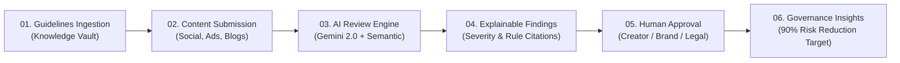

# TRVST AI — Intelligent Brand Governance Platform
> **A practical review layer that helps teams publish on-brand, accurate, accessible content with people in control.**  
> *Developed by Team Spider for Round 1 & MVP Submission — October 2026*

🌐 **Live Demo (GitHub Pages):** [https://noteforstudy1-tech.github.io/trvst-ai/](https://noteforstudy1-tech.github.io/trvst-ai/)

[](https://noteforstudy1-tech.github.io/trvst-ai/)
[](https://github.com/noteforstudy1-tech/trvst-ai)
[](https://aistudio.google.com)
[](https://fastapi.tiangolo.com)

---

## 🌟 Executive Summary

Brand rules, approved facts, and visual standards are scattered across disparate documents, slide decks, and teams. When teams publish across multiple channels under tight deadlines, consistency breaks down:
- **Voice drifts**: Different writers interpret tone inconsistently.
- **Facts go stale**: Outdated pricing, obsolete specs, and retired claims slip through.
- **Claims carry legal risk**: Unqualified promises or missing disclaimers expose companies to regulatory liability.
- **Review gets stuck**: Ambiguous feedback loops cause slow approvals and repeated revisions.

**TRVST AI** transforms brand guidelines from a dormant PDF reference document into an **active, repeatable pre-publication review checkpoint** right inside the content workflow.



---

## 🚀 Key Capabilities

### 1. 📚 Knowledge Vault
- **Brand Rules**: Codified policies across legal compliance, fact verification, brand voice, and visual accessibility.
- **Approved Facts Matrix**: Authoritative claims, current pricing structures ($49/mo Starter), and compliance certifications (SOC2 Type II).
- **Prohibited & Preferred Terminology**: Live dictionary intercepting dangerous buzzwords (`100% risk-free`, `zero errors`, `cheap`) and offering compliant alternatives.

### 2. 🔍 Explainable Multi-Format AI Review
- **Severity with Meaning**: Categorizes flags into **Critical** (blocks publication), **Moderate** (fact inconsistency), and **Minor** (tone/style preference).
- **Rule-Linked Citations**: Every finding explicitly quotes the violated policy and explains the regulatory or brand rationale.
- **1-Click Compliant Rewrites**: Click "Apply Rewrite" to drop in a contextual, approved alternative in real-time.

### 3. 🛡️ Human-in-the-Loop Approval Workflow
- Role-based permissions supporting 4 enterprise personas:
  - **Creators & Designers**: Instant feedback with low-friction 1-click fixes.
  - **Brand & Marketing Leads**: Visibility into repeat exceptions and tone consistency.
  - **Legal & Compliance**: Audit controls, severity gating, and formal sign-offs.
  - **Agencies & Freelancers**: Immediate alignment without reading 50-page brand books.
- Comprehensive immutable audit trail tracking all approvals, overrides, and escalations.

### 4. 📊 Governance Insights Dashboard
- **Risk Reduction Velocity**: Measures intercepted critical blockers pre-publication against baseline hypotheses (targeting **90% reduction in brand risk**).
- **Turnaround Velocity**: Real-time velocity tracking (targeting **60% faster approvals**).
- **Recurring Violation Frequency**: Interactive charts illustrating which brand guidelines cause repeated confusion.

### 5. ⚡ Dual-Mode AI Architecture
- **Mode A (Live Google Gemini 2.0 Flash)**: Connects to Google AI Studio for deep multimodal reasoning and contextual rewrites.
- **Mode B (TRVST Semantic Heuristic Engine)**: Instant offline fallback guaranteeing that **your live demo never crashes**, even with zero internet or rate limits!

---

## ⚡ 1-Click Quickstart

### Prerequisites
- macOS or Linux with **Python 3.9+** (already pre-installed on macOS).

### Launching the Application
From the terminal, run:

```bash
cd /Users/raghavparashar/Downloads/trvst-ai
./run.sh
```

The script will automatically initialize the Python virtual environment, install required packages, launch the FastAPI server, and open your browser at:
👉 **`http://127.0.0.1:8000`**

---

## 🎯 Live Demo Walkthrough (for Judges)

When presenting, use the **Demo Scenario Toolbar** at the top of the Review Workspace:

1. **Scenario 1: High-Risk Fintech Campaign**
   - Click the preset button.
   - Click **Run TRVST AI Review**.
   - Notice the score drops to ~30 (High Risk).
   - Show the 3 Critical Flags (unqualified guarantee `"100% risk-free"` and legacy `$29/mo` pricing).
   - Click **Apply Rewrite** on the guarantee flag — watch the editor update instantly and the score re-calculate!
   - Switch persona to **Legal & Compliance** and click **Escalate to Legal** or **Approve**.

2. **Scenario 2: Stale Blog Announcement**
   - Click preset 2.
   - Run Review to see the citation intercepting outdated `"SOC1"` claims vs. verified `"SOC2 Type II"`.

3. **Scenario 3: Fully Compliant Release**
   - Click preset 3.
   - Run Review — watch it achieve a 98/100 score with instant **Ready to Publish** certification.

4. **Explore Governance Insights**:
   - Click the **Governance Insights** tab to present the real-time KPI cards, violation breakdown bar chart, and audit log.

---

## 🧪 Automated Testing

TRVST AI includes full automated test coverage for API endpoints, Knowledge Vault integrity, AI analysis, and workflow transitions:

```bash
cd /Users/raghavparashar/Downloads/trvst-ai
source venv/bin/activate
PYTHONPATH=. pytest tests/ -v
```

All 6 test suites validate clean execution.

---

## 👥 Team Spider — Team Members & Roles

| Member | Role | Key Contributions |
| :--- | :--- | :--- |
| **Raghav Parashar** | Team Lead & Full-Stack Architect | System design, FastAPI backend, database, integration, and launcher |
| **Vritika Sheth** | AI / ML Engineer | Knowledge retrieval, Gemini prompts, semantic checks, and visual rules |
| **Tatvagna Tandel** | Frontend & UI/UX Designer | Review workspace, split-screen editor, design system, and analytics UI |
| **Sujay Tudu** | QA Specialist & Technical Writer | Test suites, rule verification, edge-case hardening, and documentation |
| **Tanay Chavan** | Backend Developer | File storage, data persistence, API routing, and performance tuning |
| **Radha Gautam** | Research & Presentation Lead | User research, competitor benchmarking, pitch narrative, and demo flow |

---

*TRVST AI — Built for the 2026 Online Hackathon by Team Spider.*
